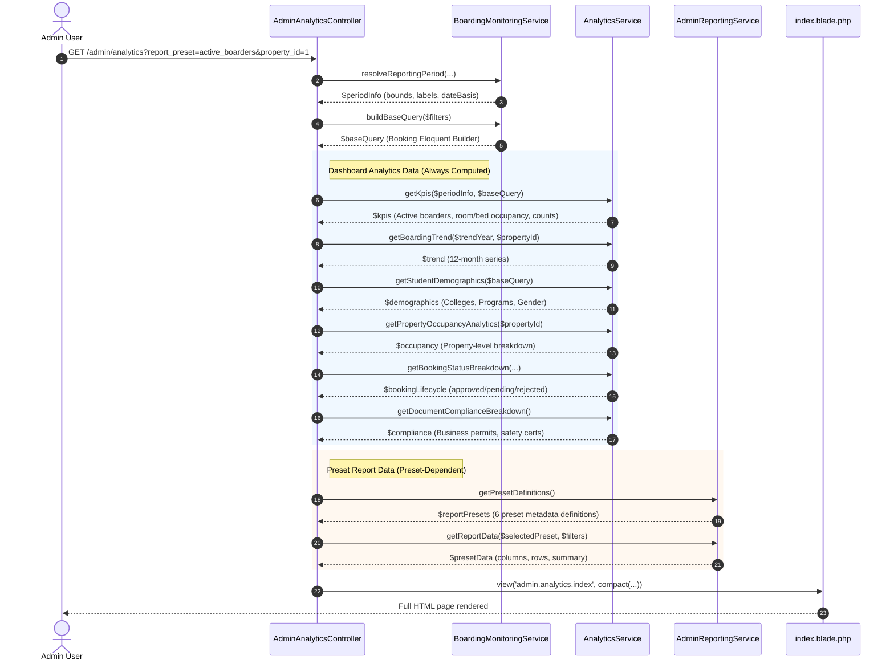

# 01 — Architecture Overview: Admin Analytics & Institutional Reporting

## Executive Summary
This document outlines the end-to-end architecture of the Analytics and Institutional Reporting module (`/admin/analytics`) in the Online Boarding House System (OBHS). It traces request dispatching, controller execution, service integration, database query composition, and Blade template rendering.

---

## 1. System Context & Route Architecture

The Analytics module resides under the `Admin` portal domain and is registered in [`routes/web.php`](file:///c:/Users/JC%20Zamora/Downloads/Mark-Capstone/obhs/routes/web.php#L351-L354).

```mermaid
flowchart TD
    Client[Browser / Admin User] -->|GET /admin/analytics| RouteIndex[Route: admin.analytics.index]
    Client -->|GET /admin/analytics/export| RouteExport[Route: admin.analytics.export]
    Client -->|Print Button| ClientPrint[Browser window.print]

    subgraph Middleware Stack
        RouteIndex --> AuthCheck[Auth::check && role:admin]
        RouteExport --> AuthCheckExport[Auth::check && role:admin]
    end

    AuthCheck --> AdminAnalyticsController[AdminAnalyticsController@index]
    AuthCheckExport --> AdminAnalyticsControllerExport[AdminAnalyticsController@exportCsv]

    subgraph Service Layer
        AdminAnalyticsController --> BoardingMonitoringService[BoardingMonitoringService]
        AdminAnalyticsController --> AnalyticsService[AnalyticsService]
        AdminAnalyticsController --> AdminReportingService[AdminReportingService]
    end

    subgraph Rendering
        AdminAnalyticsController --> IndexBlade[resources/views/admin/analytics/index.blade.php]
        AdminAnalyticsControllerExport --> CsvStream[StreamedResponse: UTF-8 BOM CSV]
    end
```

### Route Summary Table
| URI | HTTP Method | Route Name | Controller & Method | Middleware | Response Type | Purpose |
|---|---|---|---|---|---|---|
| `/admin/analytics` | `GET` | `admin.analytics.index` | [`AdminAnalyticsController@index`](file:///c:/Users/JC%20Zamora/Downloads/Mark-Capstone/obhs/app/Http/Controllers/AdminAnalyticsController.php#L20) | `web`, `auth`, `verified`, `role:admin` | `View (Blade HTML)` | Combined Analytics Dashboard & Report Preset Table View |
| `/admin/analytics/export` | `GET` | `admin.analytics.export` | [`AdminAnalyticsController@exportCsv`](file:///c:/Users/JC%20Zamora/Downloads/Mark-Capstone/obhs/app/Http/Controllers/AdminAnalyticsController.php#L95) | `web`, `auth`, `verified`, `role:admin` | `StreamedResponse (text/csv)` | Download CSV export of selected report preset |

---

## 2. Controller & Service Execution Flow

When an administrator loads `/admin/analytics?report_preset=active_boarders`, the execution flow proceeds as follows:



---

## 3. Data Dependency Classification

| Dataset Variable | Generated By | Depends on `report_preset`? | Depends on Period Filter? | Depends on Property Filter? | Depends on College Filter? |
|---|---|---|---|---|---|
| `$kpis` | `AnalyticsService@getKpis` | **NO** | YES | YES | YES |
| `$trend` | `AnalyticsService@getBoardingTrend` | **NO** | NO (Uses Year) | YES | NO |
| `$demographics` | `AnalyticsService@getStudentDemographics` | **NO** | YES | YES | YES |
| `$occupancy` | `AnalyticsService@getPropertyOccupancyAnalytics` | **NO** | NO | YES | NO |
| `$bookingLifecycle` | `AnalyticsService@getBookingStatusBreakdown` | **NO** | YES | NO | NO |
| `$compliance` | `AnalyticsService@getDocumentComplianceBreakdown` | **NO** | NO | NO | NO |
| `$filterOptions` | `BoardingMonitoringService@getFilterOptions` | **NO** | NO | NO | NO |
| `$reportPresets` | `AdminReportingService@getPresetDefinitions` | **NO** | NO | NO | NO |
| **`$presetData`** | `AdminReportingService@getReportData` | **YES** | **YES** (Only some presets) | **YES** (Only some presets) | **YES** (Only some presets) |

---

## 4. Key Architectural Insights

1. **Monolithic Page Assembly:**
   `AdminAnalyticsController@index` unconditionally constructs and passes all dashboard charts, trend lines, gender subqueries, compliance cards, and KPI calculations on every request. Even when an admin only wants to view or export a specific report preset, all 7 analytical queries execute.
2. **Decoupled Preset Table:**
   `$presetData` is the *only* variable in the controller and view that switches its schema and data rows when `report_preset` changes.
3. **No Isolated Print Context:**
   The page provides `window.print()` directly on the full monolithic dashboard, with no dedicated print controller, route, or `@media print` CSS isolating the selected report preview.
