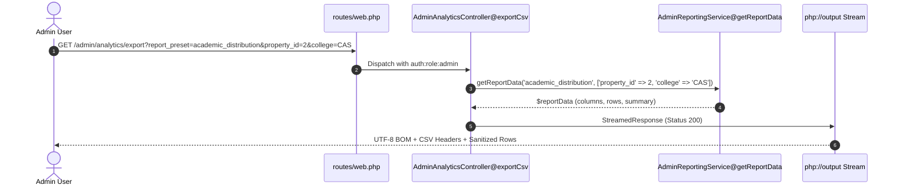

# 05 — CSV Export Audit

## Overview
This document evaluates the CSV Export implementation in [`AdminAnalyticsController@exportCsv`](file:///c:/Users/JC%20Zamora/Downloads/Mark-Capstone/obhs/app/Http/Controllers/AdminAnalyticsController.php#L95) and assesses its data integrity, standards compliance, and filter fidelity.

---

## 1. Technical Execution Flow



---

## 2. CSV Specification Compliance Checklist

| Standard / Requirement | Implementation | Status | Evidence / Code Reference |
|---|---|---|---|
| **Role Authorization** | Strict admin role check | **PASS** | `AdminAnalyticsController.php:97-99` (`Auth::user()->role !== 'admin' -> abort(403)`) |
| **Response Type** | `StreamedResponse` | **PASS** | `response()->stream($callback, 200, $headers)` (Low memory usage) |
| **Character Encoding** | UTF-8 with BOM | **PASS** | `AdminAnalyticsController.php:125` (`fprintf($handle, chr(0xEF).chr(0xBB).chr(0xBF))`) |
| **CSV Injection Protection** | Sanitizes `=`, `+`, `-`, `@` prefixes | **PASS** | `AdminAnalyticsController.php:130` (`preg_match('/^[=\+\-\@]/', (string) $str) ? "'" . $str : ...`) |
| **Filename Convention** | Institutional prefix + Preset + Timestamp | **PASS** | `AdminAnalyticsController.php:112` (`'minsu_obhs_' . $selectedPreset . '_' . now()->format('Y-m-d_His') . '.csv'`) |
| **Dynamic Header Alignment** | Uses `$reportData['columns']` | **PASS** | `fputcsv($handle, $reportData['columns'])` matches data row keys |
| **Null / Scalar Coercion** | Explicit string/array coercion | **PASS** | `AdminAnalyticsController.php:133-134` |
| **Preset Fidelity** | Binds to `$selectedPreset` | **PASS** | Correctly exports the dataset matching the active preset |

---

## 3. Discovered Filter Gaps in CSV Export

While the CSV streaming mechanics are robust, the query parameter propagation in the controller and view contains gaps:

1. **Ignored Period & Date Range Filters:**
   [`AdminAnalyticsController.php:101-109`](file:///c:/Users/JC%20Zamora/Downloads/Mark-Capstone/obhs/app/Http/Controllers/AdminAnalyticsController.php#L101-L109):
   ```php
   $propertyId = $request->filled('property_id') ? (int) $request->query('property_id') : null;
   $college = $request->query('college');
   $selectedPreset = $request->query('report_preset', AdminReportingService::PRESET_OCCUPANCY_AVAILABILITY);

   $filters = [
       'property_id' => $propertyId,
       'college' => $college,
   ];
   ```
   *Impact:* Any date range or reporting period selected in the filter UI is discarded upon clicking "Export CSV".

2. **Omitted Academic Program Filter:**
   The `program` filter is not captured in `$filters` or appended to the export button URL in [`index.blade.php:21-23`](file:///c:/Users/JC%20Zamora/Downloads/Mark-Capstone/obhs/resources/views/admin/analytics/index.blade.php#L21-L23).
