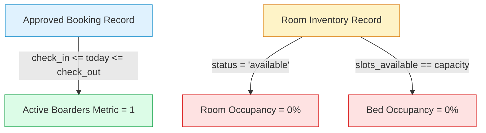

# 06 — Data Accuracy & Metric Reconciliation Audit

## Executive Summary
This document addresses the user-reported data discrepancy where the Admin Analytics dashboard displays **Active Boarders: 1**, **Registered Students: 1**, but **Room Occupancy: 0%** and **Bed Occupancy: 0%**.

---

## 1. Metric Definition & Source Comparison

| Metric | Display Location | Source Model & Query | Counting Unit & Formula | Status & Date Criteria | Denominator |
|---|---|---|---|---|---|
| **Active Boarders** | KPI Card 1 | `Booking` table via `BoardingMonitoringService::getSummaryMetrics` | Unique Students: `COUNT(DISTINCT bookings.student_id)` | `status = 'approved'` AND `check_in <= TODAY` AND (`check_out IS NULL` OR `check_out > TODAY`) | N/A |
| **Registered Students** | KPI Card 2 | `User` table | Count of users where `role = 'student'` | Any registered student account | N/A |
| **Room Occupancy Rate** | KPI Card 3 | `Room` table aggregate query via `AnalyticsService::getKpis` | `(occupied_rooms / total_rooms) * 100` where `occupied_rooms = SUM(CASE WHEN status = 'occupied' THEN 1 ELSE 0 END)` | `rooms.status = 'occupied'` (Direct room inventory status flag) | `COUNT(*)` of all rooms in database |
| **Bed Occupancy Rate** | KPI Card 4 | `Room` table aggregate query via `AnalyticsService::getKpis` | `(occupied_beds / total_capacity) * 100` where `occupied_beds = total_capacity - slots_available` | Calculated strictly from `rooms.capacity` and `rooms.slots_available` columns | `SUM(rooms.capacity)` of all rooms in database |

---

## 2. Root Cause of the Observed Discrepancy

### Technical Root Cause: Decoupled State Management
1. **Active Boarders metric** is calculated dynamically from **transactional stay records (`Booking` model)**. If a student has an approved booking active today, `active_boarders = 1`.
2. **Room & Bed Occupancy metrics** in `AnalyticsService` are calculated statically from the **inventory status columns on the `Room` table** (`rooms.status` and `rooms.slots_available`).
3. If an approved booking was created (e.g., via seeding, direct approval, or manual onboarding) without decrementing `rooms.slots_available` or changing `rooms.status` to `'occupied'`, the room remains `status = 'available'` with full slots.
4. Consequently:
   - Active Boarders = 1
   - Occupied Rooms (`rooms.status = 'occupied'`) = 0 / Total Rooms = **0%**
   - Occupied Beds (`capacity - slots_available`) = 0 / Total Capacity = **0%**

---

## 3. Date Semantics & Check-Out State

In addition to state decoupling:
- If a booking's `check_in` is in the future, or if `check_out` has passed today's date, `Active Boarders` drops to `0`.
- If the global filter has a custom date range (e.g., historical month), `getKpis` passes `$periodInfo` into `getSummaryMetrics`, which evaluates stay overlap during that period, whereas room inventory reflects the *current physical instant*.

---

## 4. Reconciliation Recommendations

1. **Transactional Room Occupancy Alignment:**
   Ensure room inventory triggers (`slots_available` decrement and `status` updates) execute atomically upon booking approval and tenant onboarding completion.
2. **Dynamic Period-Aware Occupancy Calculation:**
   Alternatively, for historical reporting, room and bed occupancy should be computed from concurrent active booking stays rather than static snapshot columns on `rooms`.
