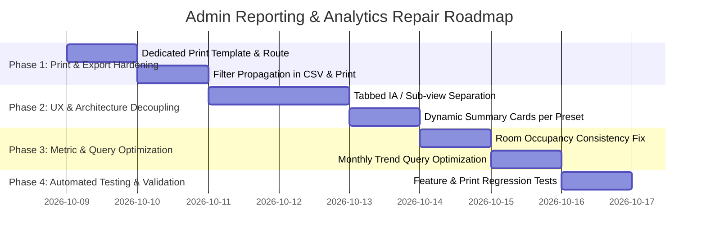

# 10 — Recommended Implementation Plan

## Overview
This document outlines a structured, phased implementation roadmap to resolve all identified UX, reporting, printing, filter, and data consistency issues in the Admin Analytics and Institutional Reporting system.

---

## Phase Breakdown & Roadmap

---

## Workstream Details

### Workstream A: Dedicated Printable Report Architecture (Priority: HIGH)
- **Objective:** Enable clean, single/multi-page A4 printing of the selected institutional report without application navigation or dashboard noise.
- **Implementation Steps:**
  1. Add route `GET /admin/analytics/print` in `routes/web.php` pointing to `AdminAnalyticsController@printReport`.
  2. Implement `printReport` method resolving active preset and filters via `AdminReportingService`.
  3. Create Blade view `resources/views/admin/analytics/print.blade.php` modeled after `boarded_students/print.blade.php`:
     - Official MinSU Letterhead header.
     - Document metadata box (Report Type, Date Generated, Active Filter tags, Total Count).
     - Clean, bordered data table with `@page { size: A4 landscape; margin: 12mm 15mm; }`.
     - Certified signature section at bottom.
     - Auto-print script: ``.
  4. Update "Print Report" button on Analytics page to open `/admin/analytics/print?report_preset=...` in a new tab.

---

### Workstream B: Information Architecture & Preset Separation (Priority: HIGH)
- **Objective:** Eliminate confusion between global exploratory analytics and report generation.
- **Implementation Steps:**
  1. Restructure `resources/views/admin/analytics/index.blade.php` with a top-level tab switcher:
     - **Tab 1: Analytics & Trends** (KPI metric cards, Monthly activity chart, Booking lifecycle doughnut, Demographics charts, Compliance breakdown).
     - **Tab 2: Institutional Reports** (Preset selector pills, Filter toolbar, Contextual summary metrics for the selected preset, Dynamic data table, Export CSV & Print Report action buttons).
  2. Optimize controller to conditionally bypass heavy demographic/trend queries when the user is explicitly requesting Tab 2.

---

### Workstream C: Filter Propagation & CSV Alignment (Priority: HIGH)
- **Implementation Steps:**
  1. Update `AdminAnalyticsController@exportCsv` to receive `$request->all()` and resolve `$periodInfo` via `BoardingMonitoringService`.
  2. Pass `$filters` containing `periodStart`, `periodEnd`, `dateBasis`, `property_id`, `college`, and `program` into `AdminReportingService@getReportData`.
  3. Update `AdminReportingService@getActiveBoardersData` to respect `$filters['periodStart']` and `$filters['periodEnd']` when provided.

---

### Workstream D: Metric Consistency & Query Performance (Priority: MEDIUM)
- **Implementation Steps:**
  1. Reconcile room occupancy calculation in `AnalyticsService::getKpis` or document clearly on the UI that Room Occupancy reflects active room status inventory.
  2. Refactor `AnalyticsService::getBoardingTrend` to combine 12 monthly iterations into a single grouped query.

---

### Workstream E: Automated Regression Testing (Priority: HIGH)
- **Implementation Steps:**
  1. Add tests in `tests/Feature/AdminInstitutionalReportingTest.php` verifying:
     - `GET /admin/analytics/print` returns 200 and renders correct preset title and data.
     - All 6 presets export accurate filtered CSVs with custom date parameters.
     - Non-admin access to print route is blocked with 403.
