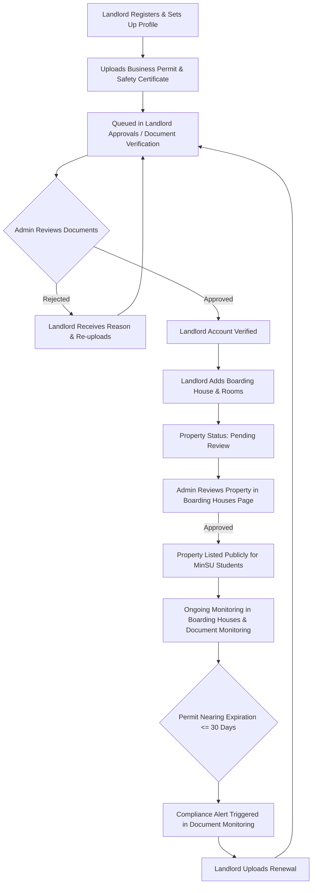
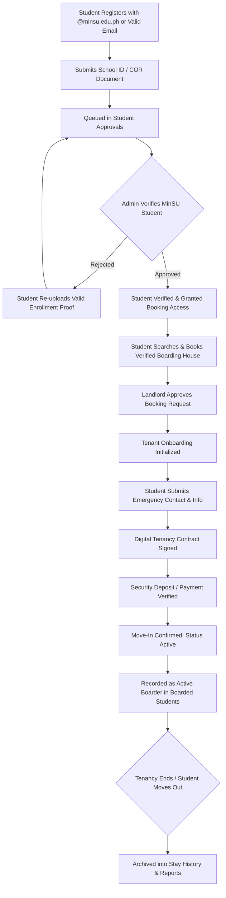
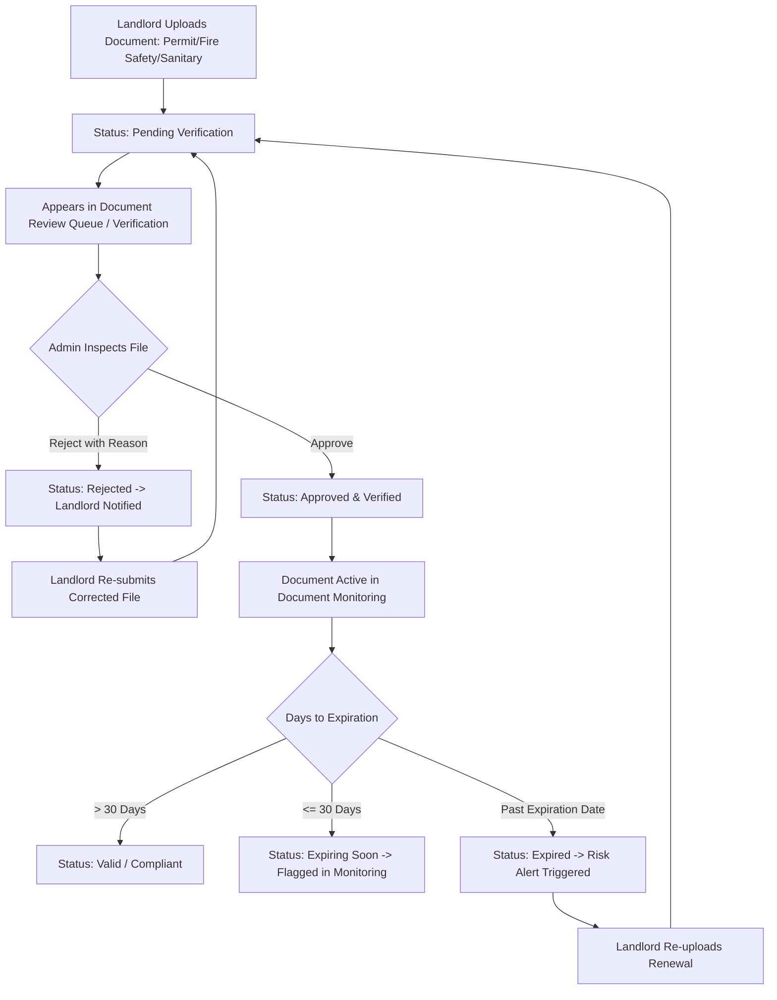

# OBHS Admin Operations — Cross-Page Workflow Map

This document traces the four core lifecycle workflows across the system and maps them directly to the corresponding administrative oversight pages.

---

## 1. Complete Workflow Diagrams

### FLOW A — Landlord Accreditation & Property Lifecycle



**Admin Page Responsibilities:**
1. Initial Credential Review: `Landlord Approvals` (`/admin/approvals/landlords`) & `Document Verification` (`/admin/documents/verification`).
2. Physical Property Review: `Boarding Houses` (`/admin/properties`).
3. Ongoing Operational Monitoring: `Boarding Houses` (`/admin/properties`).
4. Annual Compliance Expiry & Risk Monitoring: `Document Monitoring` (`/admin/documents/monitoring`).

---

### FLOW B — Student Verification & Housing Tenancy Lifecycle



**Admin Page Responsibilities:**
1. Enrollment Verification: `Student Approvals` (`/admin/approvals/students`).
2. Tenancy Pipeline Tracking: `Onboardings` (`/admin/onboardings`).
3. Real-Time Student Residency & Safety Roster: `Boarded Students - Current Boarders` (`/admin/boarding-monitoring/students?tab=current`).
4. Historical Auditing & Institutional Analytics: `Boarded Students - History & Analytics` (`/admin/boarding-monitoring/students?tab=history` / `tab=analytics`).

---

### FLOW C — Document Compliance Lifecycle



**Admin Page Responsibilities:**
1. Review & Verification Queue: `Document Verification` (`/admin/documents/verification`).
2. Compliance & Expiry Monitoring: `Document Monitoring` (`/admin/documents/monitoring`).

---

### FLOW D — Physical Property & Room Occupancy Lifecycle

```mermaid
flowchart TD
    A[Property Created with Room Capacities] --> B[Status: Pending Approval]
    B --> C[Admin Inspects Location, Photos, Room Count]
    C --> D{Admin Decision}
    D -- Reject --> E[Landlord Edits Listing]
    E --> B
    D -- Approve --> F[Status: Approved & Active]
    F --> G[Public Listing Visible on Map & Search]
    G --> H[Students Move In via Completed Onboardings]
    H --> I[Occupancy Rate Automatically Increments]
    I --> J{Capacity Reached?}
    J -- Slots Available --> K[Status: Available (Green)]
    J -- 100% Full --> L[Status: Full / No Vacancy (Red)]
```

**Admin Page Responsibilities:**
1. Property Approval & Oversight: `Boarding Houses` (`/admin/properties`).
2. Bed Capacity & Spatial Mapping: `Boarding Houses` (`/admin/properties`).
3. Resident Occupancy Reconciliation: `Boarded Students` (`/admin/boarding-monitoring/students`).
