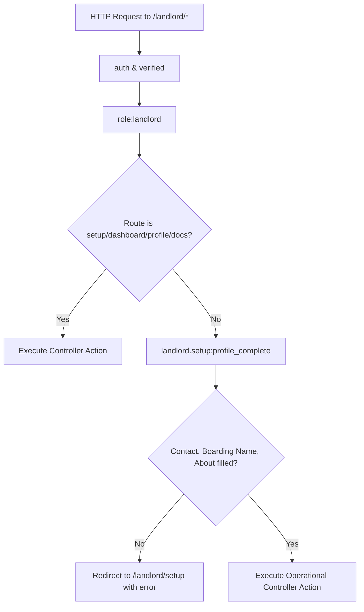

# Landlord Portal — Complete Route & Architecture Map

**Target:** OBHS Landlord Portal  
**Framework:** Laravel 12 / PHP 8.2+ / Blade / Vite  
**Audit Date:** 2026-10-08  

---

## 1. Full Landlord Route Inventory

| HTTP Method | URI | Route Name | Controller & Action | Middleware Applied | Purpose & Data Mutation |
| :--- | :--- | :--- | :--- | :--- | :--- |
| `GET` | `/landlord/setup` | `landlord.setup.show` | `LandlordSetupController@show` | `auth, verified, role:landlord` | Multi-step onboarding wizard for new landlords. |
| `PUT` | `/landlord/setup` | `landlord.setup.update` | `LandlordSetupController@update` | `auth, verified, role:landlord` | Updates profile, uploads permits, sets payment options. |
| `GET` | `/landlord/dashboard` | `landlord.dashboard` | `AuthController@landlordDashboard` | `auth, verified, role:landlord` | Operational KPIs, property cards, watchlist, recent messages. |
| `GET` | `/landlord/documents` | `landlord.documents.index` | `LandlordDocumentController@index` | `auth, verified, role:landlord` | Compliance document submission desk and status monitor. |
| `POST` | `/landlord/documents` | `landlord.documents.store` | `LandlordDocumentController@store` | `auth, verified, role:landlord` | Submits new regulatory document version. |
| `POST` | `/landlord/documents/{document}/resubmit` | `landlord.documents.resubmit` | `LandlordDocumentController@resubmit` | `auth, verified, role:landlord` | Resubmits rejected or expiring document version. |
| `GET` | `/landlord/profile` | `landlord.profile.edit` | `AuthController@landlordProfile` | `auth, verified, role:landlord` | Profile, e-signature, and payment settings form. |
| `PUT` | `/landlord/profile` | `landlord.profile.update` | `AuthController@updateLandlordProfile` | `auth, verified, role:landlord` | Updates user details, boarding house name, e-signature. |
| `GET` | `/landlord/properties` | `landlord.properties.index` | `PropertyController@index` | `auth, verified, role:landlord, landlord.setup:profile_complete` | Lists all properties owned by landlord. |
| `GET` | `/landlord/properties/create` | `landlord.properties.create` | `PropertyController@create` | `auth, verified, role:landlord, landlord.setup:profile_complete` | Property creation form with amenities and house rules. |
| `POST` | `/landlord/properties` | `landlord.properties.store` | `PropertyController@store` | `auth, verified, role:landlord, landlord.setup:profile_complete` | Creates property, triggers geocoding, uploads cover image. |
| `GET` | `/landlord/properties/{property}` | `landlord.properties.show` | `PropertyController@show` | `auth, verified, role:landlord, landlord.setup:profile_complete` | Property detailed overview, room list, active tenants. |
| `GET` | `/landlord/properties/{property}/edit` | `landlord.properties.edit` | `PropertyController@edit` | `auth, verified, role:landlord, landlord.setup:profile_complete` | Property editing form. |
| `PUT` | `/landlord/properties/{property}` | `landlord.properties.update` | `PropertyController@update` | `auth, verified, role:landlord, landlord.setup:profile_complete` | Updates property metadata and house rules. |
| `DELETE` | `/landlord/properties/{property}` | `landlord.properties.destroy` | `PropertyController@destroy` | `auth, verified, role:landlord, landlord.setup:profile_complete` | Deletes property (cascades to rooms and bookings). |
| `GET` | `/landlord/properties/{property}/rooms` | `landlord.properties.rooms.index` | `RoomController@index` | `auth, verified, role:landlord, landlord.setup:profile_complete` | Room directory for specific property. |
| `GET` | `/landlord/properties/{property}/rooms/create` | `landlord.properties.rooms.create` | `RoomController@create` | `auth, verified, role:landlord, landlord.setup:profile_complete` | Form to create room with pricing model and gallery. |
| `POST` | `/landlord/properties/{property}/rooms` | `landlord.properties.rooms.store` | `RoomController@store` | `auth, verified, role:landlord, landlord.setup:profile_complete` | Creates room, sets pricing structure, syncs availability. |
| `GET` | `/landlord/properties/{property}/rooms/{room}/edit` | `landlord.properties.rooms.edit` | `RoomController@edit` | `auth, verified, role:landlord, landlord.setup:profile_complete` | Room edit form. |
| `PUT` | `/landlord/properties/{property}/rooms/{room}` | `landlord.properties.rooms.update` | `RoomController@update` | `auth, verified, role:landlord, landlord.setup:profile_complete` | Updates room capacity, pricing, gallery photos. |
| `DELETE` | `/landlord/properties/{property}/rooms/{room}` | `landlord.properties.rooms.destroy` | `RoomController@destroy` | `auth, verified, role:landlord, landlord.setup:profile_complete` | Deletes room (cascades to bookings). |
| `POST` | `/landlord/dashboard/properties/{property}/rooms` | `landlord.dashboard.rooms.quick_store` | `RoomController@quickStore` | `auth, verified, role:landlord, landlord.setup:profile_complete` | Modal quick-add room directly from landlord dashboard. |
| `GET` | `/landlord/rooms` | `landlord.rooms.index` | `RoomController@landlordIndex` | `auth, verified, role:landlord, landlord.setup:profile_complete` | Centralized room directory across all properties. |
| `GET` | `/landlord/bookings` | `landlord.bookings.index` | `BookingController@landlordIndex` | `auth, verified, role:landlord, landlord.setup:profile_complete` | Boarding requests queue (pending, approved, rejected). |
| `POST` | `/landlord/bookings/{booking}/approve` | `landlord.bookings.approve` | `BookingController@approve` | `auth, verified, role:landlord, landlord.setup:profile_complete` | Approves booking, initiates onboarding record, syncs slots. |
| `POST` | `/landlord/bookings/{booking}/reject` | `landlord.bookings.reject` | `BookingController@reject` | `auth, verified, role:landlord, landlord.setup:profile_complete` | Rejects boarding request. |
| `GET` | `/landlord/tenants` | `landlord.tenants.index` | `BookingController@landlordTenants` | `auth, verified, role:landlord, landlord.setup:profile_complete` | Directory of approved boarders and active stays. |
| `GET` | `/landlord/onboarding` | `landlord.onboarding.index` | `TenantOnboardingController@landlordIndex` | `auth, verified, role:landlord, landlord.setup:profile_complete` | Tenant onboarding queue across properties. |
| `GET` | `/landlord/onboarding/{onboarding}/review` | `landlord.onboarding.review` | `TenantOnboardingController@reviewDocuments` | `auth, verified, role:landlord, landlord.setup:profile_complete` | Document verification & payment review screen. |
| `GET` | `/landlord/onboarding/{onboarding}/contract` | `landlord.onboarding.contract` | `TenantOnboardingController@viewContract` | `auth, verified, role:landlord, landlord.setup:profile_complete` | In-app visual lease agreement review. |
| `GET` | `/landlord/onboarding/{onboarding}/contract-pdf` | `landlord.onboarding.contract_pdf` | `TenantOnboardingController@downloadContractPdf` | `auth, verified, role:landlord, landlord.setup:profile_complete` | Streams legal-size lease agreement PDF. |
| `POST` | `/landlord/onboarding/{onboarding}/sign-contract` | `landlord.onboarding.sign_contract` | `TenantOnboardingController@signContractAsLandlord` | `auth, verified, role:landlord, landlord.setup:profile_complete` | Applies landlord profile e-signature to lease agreement. |
| `POST` | `/landlord/onboarding/{onboarding}/approve-documents` | `landlord.onboarding.approve_documents` | `TenantOnboardingController@approveDocuments` | `auth, verified, role:landlord, landlord.setup:profile_complete` | Approves/rejects docs, confirms deposit, completes onboarding. |
| `GET` | `/landlord/payments` | `landlord.payments.index` | `PaymentController@index` | `auth, verified, role:landlord, landlord.setup:profile_complete` | Billing & payment ledger with status filters (paid/pending/overdue). |
| `GET` | `/landlord/payments/{booking}/manage` | `landlord.payments.manage` | `PaymentController@manageMonthly` | `auth, verified, role:landlord, landlord.setup:profile_complete` | Tenant-specific monthly billing ledger and manual entry. |
| `POST` | `/landlord/payments/{booking}/paid` | `landlord.payments.mark_paid` | `PaymentController@markAsPaid` | `auth, verified, role:landlord, landlord.setup:profile_complete` | Marks current monthly cycle as received. |
| `POST` | `/landlord/payments/{booking}/pending` | `landlord.payments.mark_pending` | `PaymentController@markAsPending` | `auth, verified, role:landlord, landlord.setup:profile_complete` | Reverts payment status to pending. |
| `POST` | `/landlord/payments/{booking}/remind` | `landlord.payments.remind` | `PaymentController@sendReminder` | `auth, verified, role:landlord, landlord.setup:profile_complete` | Sends email & in-app reminder with GCash QR to student. |
| `POST` | `/landlord/payments/{booking}/records` | `landlord.payments.records.store` | `PaymentController@storeMonthlyRecord` | `auth, verified, role:landlord, landlord.setup:profile_complete` | Creates manual monthly payment transaction. |
| `POST` | `/landlord/payments/{booking}/records/{record}/status` | `landlord.payments.records.status` | `PaymentController@updateMonthlyRecordStatus` | `auth, verified, role:landlord, landlord.setup:profile_complete` | Updates individual payment record status (approved/rejected). |
| `GET` | `/landlord/leave-requests` | `landlord.leave_requests.index` | `LandlordLeaveRequestController@index` | `auth, verified, role:landlord, landlord.setup:profile_complete` | Lists tenant early move-out and departure requests. |
| `POST` | `/landlord/leave-requests/{leaveRequest}/approve` | `landlord.leave_requests.approve` | `LandlordLeaveRequestController@approve` | `auth, verified, role:landlord, landlord.setup:profile_complete` | Approves leave request, updates booking check-out. |
| `POST` | `/landlord/leave-requests/{leaveRequest}/reject` | `landlord.leave_requests.reject` | `LandlordLeaveRequestController@reject` | `auth, verified, role:landlord, landlord.setup:profile_complete` | Rejects tenant leave request. |
| `GET` | `/landlord/maintenance` | `landlord.maintenance.index` | `MaintenanceController@index` | `auth, verified, role:landlord, landlord.setup:profile_complete` | Lists rooms in maintenance mode and toggle controls. |
| `POST` | `/landlord/maintenance/set` | `landlord.maintenance.set` | `MaintenanceController@setMaintenance` | `auth, verified, role:landlord, landlord.setup:profile_complete` | Sets room status to maintenance with reason. |
| `POST` | `/landlord/maintenance/{room}/complete` | `landlord.maintenance.complete` | `MaintenanceController@completeMaintenance` | `auth, verified, role:landlord, landlord.setup:profile_complete` | Restores room status to available. |
| `GET` | `/landlord/messages` | `landlord.messages.index` | `MessageController@index` | `auth, verified, role:landlord, landlord.setup:profile_complete` | Inbox and direct conversation threads with tenants/inquirers. |
| `POST` | `/admin/messages` / store | `MessageController@store` | `MessageController@store` | `auth` | Sends message reply to student. |
| `GET` | `/landlord/feedback` | `landlord.feedback.index` | `LandlordFeedbackController@index` | `auth, verified, role:landlord, landlord.setup:profile_complete` | Lists verified student reviews and ratings. |
| `POST` | `/landlord/feedback/analyze` | `landlord.feedback.analyze` | `LandlordFeedbackController@analyzePending` | `auth, verified, role:landlord, landlord.setup:profile_complete` | Triggers Hugging Face AI sentiment analysis on comments. |
| `GET` | `/landlord/analytics` | `landlord.analytics.index` | `AnalyticsController@index` | `auth, verified, role:landlord, landlord.setup:profile_complete` | Occupancy, booking trends, and revenue metrics. |
| `GET` | `/notifications` | `notifications.index` | `NotificationController@index` | `auth` | Shared notifications inbox (filtered for landlord). |
| `POST` | `/notifications/{id}/read` | `notifications.read` | `NotificationController@markRead` | `auth` | Marks notification as read and redirects to destination. |
| `POST` | `/notifications/read-all` | `notifications.read_all` | `NotificationController@markAllRead` | `auth` | Marks all unread notifications as read. |
| `GET` | `/files/{path}` | `files.show` | `FileController@show` | `auth, verified` | Authorized private file streaming (permits, signatures, proofs). |
| `POST` | `/logout` | `logout` | `AuthController@logout` | `web` | Terminates session. |

---

## 2. Middleware Architecture & Gating

### Observations on Middleware Gating:
1. `EnsureLandlordSetupStep` checks:
   - `contact_number` filled
   - `boarding_house_name` filled
   - `landlordProfile->about` filled
2. Notably, **Business Permit approval is NOT strictly gated by middleware** for all routes, but is checked in the Blade layout (`$landlordOpsLocked = !$layoutProfileComplete || !$layoutPermitApproved;`), which locks the UI links visually. This creates a minor discrepancy where direct URLs could theoretically be hit if a user knows the endpoint before permit approval, although properties themselves cannot be seen by students until admin approval.
