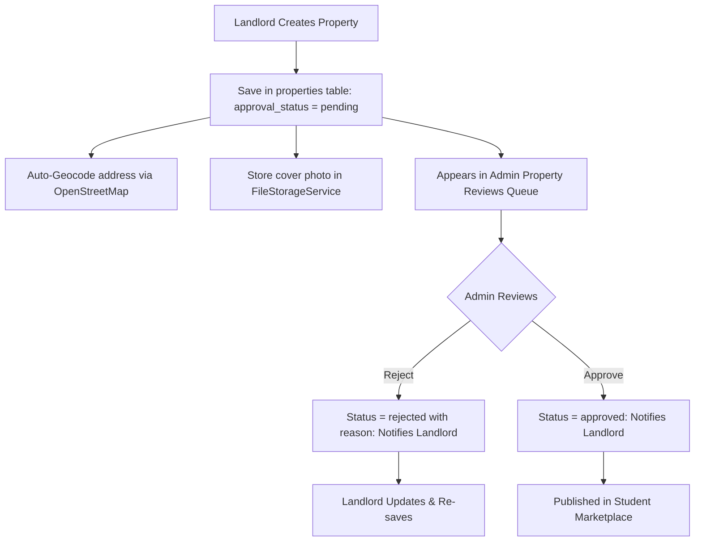

# Landlord Portal — Property, Room & Booking Audit

**Modules Audited:** Properties, Room Directory, Boarding Requests  
**Controllers:** `PropertyController`, `RoomController`, `BookingController`  
**Models:** `Property`, `Room`, `RoomImage`, `Booking`  
**Service:** `RoomOccupancyRules`  
**Date:** 2026-10-08  

---

## 1. Property Management Lifecycle



### Key Findings & Invariants:
1. **Multi-Property Support:** A single landlord can register multiple properties. Scoping is strictly enforced with `where('landlord_id', Auth::id())` and `PropertyPolicy`.
2. **Geocoding Parity:** Coordinates (`latitude`, `longitude`) are geocoded using `GeocodingService` if left blank by the landlord during create/update (`PropertyController.php:585, 738`).
3. **Approval Gating:** Unapproved properties (`pending` or `rejected`) are excluded from public search via `Property::visibleToAudience()` scope.
4. **Destructive Cascade Risk:** 
   - `PropertyController@destroy` executes `$property->delete()` without validating if active tenants or active bookings exist.
   - Migration `2025_11_19_000010_create_rooms_table.php:13` uses `cascadeOnDelete()`.
   - Migration `2025_11_19_000011_create_bookings_table.php:13` uses `cascadeOnDelete()`.
   - **Risk:** Deleting a property immediately deletes all its rooms, bookings, onboarding records, and financial payments without safety confirmations or active-tenancy blockers.

---

## 2. Room Inventory, Capacity & Pricing Models

### A. Supported Pricing Models
In `Room.php` and `RoomController.php`:
1. **`per_room` (Solo/Entire Room):**
   - Rents the entire room to a single student/group.
   - Price: `price_per_room`.
   - Any approved booking makes `available_slots = 0`.
2. **`per_bed` (Shared Bed Space):**
   - Rents individual bed slots.
   - Price: `price_per_bed`.
   - Available slots: `capacity - active_occupants_count`.
3. **`hybrid` (Flexible):**
   - Supports both `solo` and `shared` occupancy until the first booking is approved.
   - If a student books `solo`, the entire room is locked.
   - If a student books `shared`, the room switches to bed-slot mode.

### B. Room Availability Calculation (`RoomOccupancyRules.php`)
```php
// RoomOccupancyRules.php:34-40
$availableSlots = match ($pricingModel) {
    Room::PRICING_MODEL_PER_ROOM => $activeOccupantsCount > 0 ? 0 : $capacity,
    Room::PRICING_MODEL_PER_BED => max(0, $capacity - $activeOccupantsCount),
    default => $hasActiveSoloOccupancy
        ? 0
        : max(0, $capacity - $activeOccupantsCount),
};
```
- **Finding:** Room availability is dynamically derived from overlapping active bookings rather than relying solely on a static column. `syncAvailabilitySnapshot()` keeps the denormalized `slots_available` and `status` in sync.
- **Limitation in Views:** In `PropertyController@show` (lines 781-783) and `RoomController@landlordIndex` (lines 190-194):
  ```php
  $currentBooking = $room->bookings->first();
  $room->current_tenant = $currentBooking ? $currentBooking->student : null;
  ```
  This assumes 1 tenant per room. In a 4-bed shared room with 4 active tenants, only the first tenant is displayed in the table.

---

## 3. Booking Request Lifecycle & Concurrency

### A. Lifecycle States
- `pending`: Student submitted booking request.
- `approved`: Landlord approved request; onboarding created.
- `rejected`: Landlord rejected request.
- `cancelled`: Student cancelled pending request or approved leave request cancelled stay.

### B. Concurrency & Overbooking Protection
In `BookingController@approve` (lines 403–448):
1. **Pessimistic Locking:** Uses `Room::lockForUpdate()->findOrFail($booking->room_id)` inside a database transaction (`DB::transaction`).
2. **Precondition Validation:** Re-checks `if ($booking->status !== 'pending') abort(422)`.
3. **Overlapping Stay Check:** Re-verifies `$room->hasAvailableSlots()` and date overlaps.
4. **Auto-Rejection of Remaining Requests:** If approval fills the last available bed slot or is exclusive solo occupancy, all remaining overlapping `pending` bookings for that room are automatically marked `rejected` (`BookingController.php:450-458`).

---

## 4. Summary of Identified Defects & Recommendations

| Finding ID | Severity | Description | Recommended Action |
| :--- | :--- | :--- | :--- |
| **AUD-PROP-01** | **P1** | Property and Room deletion executes cascading deletes without checking for active tenancies or outstanding balances. | Add server-side pre-delete guards blocking deletion if active or pending bookings exist. |
| **AUD-ROOM-01** | **P2** | Multi-occupancy rooms only hydrate the first tenant in property/room show views. | Hydrate all active tenants (`$room->active_tenants = $room->bookings->pluck('student')`) and render tenant chips. |
| **AUD-BOOK-01** | **P2** | Booking approval immediately lists tenant in `Tenants` tab before onboarding contract is signed. | Add distinct onboarding progress badges to `Tenants` index to clarify status. |
