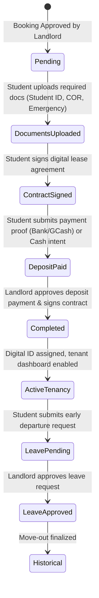

# Landlord Portal — Tenant Onboarding & Lifecycle Audit

**Modules Audited:** Tenant Onboarding, Tenant Management, Leave Requests  
**Controllers:** `TenantOnboardingController`, `BookingController`, `LandlordLeaveRequestController`, `StudentLeaveRequestController`  
**Models:** `TenantOnboarding`, `Booking`, `LeaveRequest`, `User`  
**Date:** 2026-10-08  

---

## 1. End-to-End Onboarding State Machine



---

## 2. Onboarding Workflow Detailed Audit

### A. Document Verification & Contract Generation
1. **Creation:** Automatically initialized upon booking approval in `BookingController@approve:499-503`.
   - `deposit_amount` = `monthly_rent` + (`advance_payment` if required).
   - `required_documents` = `['student_id', 'proof_of_income', 'emergency_contact']`.
2. **Student Document Upload (`uploadDocuments`):**
   - Validates file count and types (PDF, JPG, PNG).
   - Files stored privately under `tenant-onboardings/{id}/documents` via `FileStorageService`.
   - Transitions status to `documents_uploaded`.
3. **Contract Signing (`signContract` & `signContractAsLandlord`):**
   - Renders standard MinSU Residential Lease Agreement with property house rules, room inclusions, and rental terms.
   - Student draws e-signature (stored as base64 PNG in private storage).
   - Landlord applies profile e-signature via `TenantOnboardingController@signContractAsLandlord`.
   - Generates legal-size PDF via `Dompdf` (`downloadContractPdf`).

### B. Payment Submission & Approval
1. **Deposit & Advance Payment (`payDeposit`):**
   - Student selects payment method (Bank, GCash, or Cash) matching landlord's configured methods.
   - For Bank/GCash: requires reference number and payment proof screenshot.
   - Transitions status to `deposit_paid`.
2. **Landlord Confirmation (`approveDocuments:546-579`):**
   - Landlord reviews payment proof and marks `approve_payment`.
   - `onboarding->update(['deposit_paid' => true, 'deposit_paid_at' => now(), 'status' => 'completed'])`.
   - `booking->update(['payment_status' => 'paid', 'next_payment_due_date' => now()->addMonthNoOverflow()])`.
   - Student is assigned a unique digital tenant ID (e.g. `TENANT-2026-XXXX`).

---

## 3. Leave Requests & Move-Out Workflow Audit

### A. Leave Request Lifecycle
In `StudentLeaveRequestController` and `LandlordLeaveRequestController`:
- Student files departure request specifying `leave_date` and `reason`.
- Appears in landlord's `/landlord/leave-requests` queue.

### B. Critical Finding: Premature Stay Termination
- **Location:** `LandlordLeaveRequestController.php` (Lines 83–86)
```php
DB::transaction(function () use ($leaveRequest, $validator, $leaveDate) {
    $leaveRequest->update([
        'status' => 'approved',
        'landlord_response' => $validator->validated()['landlord_response'] ?? null,
        'responded_at' => now(),
    ]);

    $leaveRequest->booking->update([
        'check_out' => $leaveDate,
        'status' => 'cancelled', // <--- PREMATURE STATUS FLIP
    ]);

    $leaveRequest->booking->room->syncAvailabilitySnapshot();
});
```
- **Architectural Flaw:**
  - If a student requests to move out on **Nov 1st**, and the landlord approves on **Oct 8th**, the booking status is set to `cancelled` **immediately on Oct 8th**.
  - `RoomOccupancyRules` checks `where('status', 'approved')` -> the slot is immediately marked vacant today! Another student could book the room while the current tenant is still living there for the next 3 weeks.
  - The student vanishes from the Landlord's `Tenants` list immediately.
- **Remedy:** Keep the booking status as `approved` with the modified `check_out = $leaveDate`. Only transition the booking to `completed`/`cancelled` when `now()->toDateString() >= $leaveDate`.

---

## 4. Summary of Lifecycle Findings

| Finding ID | Severity | Module | Description | Recommended Action |
| :--- | :--- | :--- | :--- | :--- |
| **AUD-ONB-01** | **P2** | Onboarding | Landlord cannot sign contract until student has signed first. | Verified intentional business rule; ensure clear visual prompt in UI. |
| **AUD-LEV-01** | **P1** | Leave Requests | Approving a future-dated leave request immediately flips booking status to `cancelled`, freeing room capacity prematurely. | Maintain `approved` status with updated `check_out` date; transition to `completed` upon check-out date. |
| **AUD-TEN-01** | **P2** | Tenants | No move-out checklist or deposit refund tracking interface exists. | Add a move-out inspection and deposit clearance checklist. |
