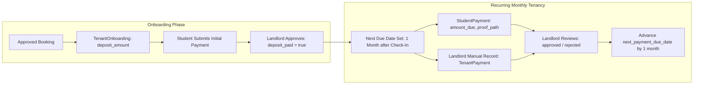

# Landlord Portal — Payments & Financial Integrity Audit

**Modules Audited:** Landlord Payments, Student Payments, Financial Analytics  
**Controllers:** `PaymentController`, `StudentPaymentController`, `AnalyticsController`  
**Models:** `TenantPayment`, `TenantOnboarding`, `Booking`  
**Date:** 2026-10-08  

---

## 1. Financial Data Architecture



---

## 2. Payment Models & Dual Ledger Structure

### A. Two Distinct Payment Phases:
1. **Initial Onboarding Payment:**
   - Captured in `tenant_onboardings` (`deposit_amount`, `advance_amount`, `deposit_paid`, `payment_proof_path`).
   - Represents initial move-in dues (1st month rent + optional 1 month advance).
2. **Recurring Monthly Rent:**
   - Captured in `tenant_payments` table (`booking_id`, `student_id`, `amount_due`, `due_date`, `status: submitted/approved/rejected`, `payment_proof_path`).
   - Represents ongoing monthly tenancy cycles.

### B. Payment Status Synchronization in `PaymentController`
- `PaymentController@index` hydrates a dual-ledger summary combining both onboarding deposit records and ongoing monthly payment rows (`lines 74–112`).
- `PaymentController@manageMonthly` provides a per-tenant ledger showing billing history, submitted payment proofs, approval actions, and manual entry forms.

---

## 3. Critical Financial Integrity Findings

### A. [P0 — Catastrophic Formula Error in `AnalyticsController`]
- **Source:** `app/Http/Controllers/AnalyticsController.php` (Lines 60–62, 72–74)
```php
$monthlyRevenue = $recentBookings->sum(function ($booking) {
    return $booking->room->price * $booking->getDurationInDays();
});
$totalExpected = $approvedBookings->sum(function ($booking) {
    return $booking->room->price * $booking->getDurationInDays();
});
```
- **Analysis:**
  - `$booking->room->price` is a **monthly rate** in Philippine Pesos (e.g. ₱2,500.00 / month).
  - `$booking->getDurationInDays()` returns the **total duration in days** (e.g., a 1-semester stay = 150 days).
  - **The calculation:** `₱2,500 * 150 = ₱375,000.00` instead of `₱2,500 * 5 months = ₱12,500.00`!
  - **Impact:** Landlord revenue charts and metrics display wildly inflated financial numbers that confuse landlords and undermine system credibility.
- **Remedy:** Revenue should be calculated as:
  `$monthlyRevenue = TenantPayment::whereIn('booking_id', $landlordBookingIds)->where('status', 'approved')->where('created_at', '>=', $thirtyDaysAgo)->sum('amount_due');`

### B. [P1 — Floating Point vs. Decimal Handling]
- In database migrations (`2026_04_05_161000_create_tenant_payments_table.php`), `amount_due` is correctly stored as `decimal(10, 2)`.
- However, in PHP controllers, amounts are cast to standard `(float)`. In PHP, floating-point arithmetic can introduce rounding precision issues (e.g. `2499.99999999999`).
- **Remedy:** Ensure all calculations use `round($val, 2)` or `bcmul` / integer centavo arithmetic where precision is strictly needed.

### C. [P2 — Conflict between "Mark as Paid" and "Monthly Records"]
- `PaymentController@markAsPaid` (lines 165–204) requires an existing `TenantPayment` record for the current cycle. If none exists, it blocks the action with: `"No monthly payment record for this cycle yet. Use Manage Monthly and create a payment record first."`
- Landlords expecting a single quick "Paid" button find this confusing.
- **Remedy:** If no record exists for the current cycle when the landlord taps "Mark as Paid", automatically generate an approved `TenantPayment` record with method `cash` to streamline manual cash collections.

---

## 4. Summary of Financial Findings

| Finding ID | Severity | Module | Description | Recommended Action |
| :--- | :--- | :--- | :--- | :--- |
| **AUD-FIN-01** | **P0** | Analytics | Revenue formula multiplies monthly rent by stay days, inflating revenue by ~30x. | Replace with actual monthly duration formula or sum of approved `tenant_payments`. |
| **AUD-FIN-02** | **P2** | Payments | "Mark as Paid" fails if tenant has not submitted a digital record. | Auto-create an approved cash `TenantPayment` row on quick "Mark as Paid". |
| **AUD-FIN-03** | **P2** | Payments | GCash QR payload lacks standardized EMVCo / BSP QR Ph format. | Standardize QR string encoding and provide clean download options. |
