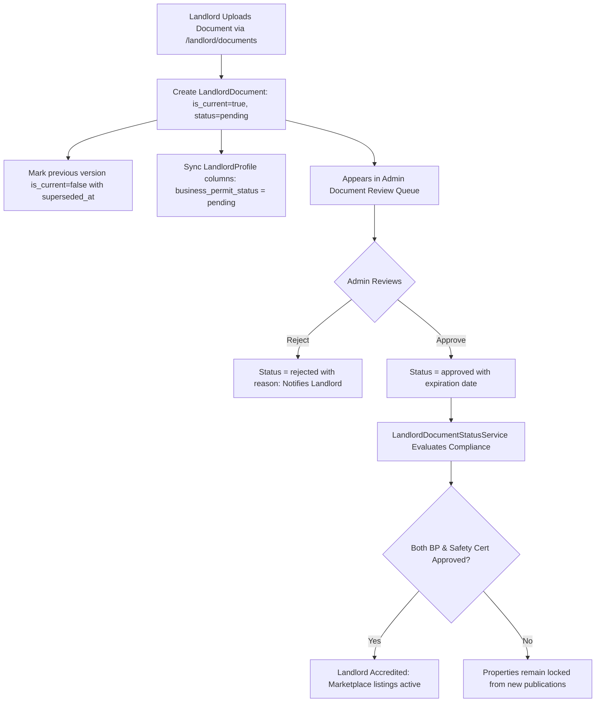

# Landlord Portal — Documents, Compliance & Notifications Audit

**Modules Audited:** Documents & Requirements, Accreditation Status, Notifications  
**Controllers:** `LandlordDocumentController`, `NotificationController`, `AdminLandlordDocumentController`  
**Services:** `LandlordDocumentStatusService`, `DocumentExpirationService`, `FileStorageService`  
**Models:** `LandlordDocument`, `LandlordProfile`, `DatabaseNotification`  
**Date:** 2026-10-08  

---

## 1. Compliance Architecture & Authoritative State

---

## 2. Document Verification & Expiration Workflow Audit

### A. Document Types Supported:
1. **Business Permit (`business_permit`):** Local LGU mayor's/business permit.
2. **Safety Certificate (`safety_certificate`):** Bureau of Fire Protection (BFP) inspection certificate.

### B. Single Source of Truth Alignment:
- In recent architecture repairs, `LandlordDocumentStatusService` established a unified hierarchy:
  1. Primary: Centralized `landlord_documents` table (`is_current = true`).
  2. Fallback: Legacy `landlord_profiles` columns (`business_permit_status`, `safety_certificate_status`).
- Both Admin Accreditation, Landlord Dashboard, Document Review Queue, and Compliance Monitoring query this exact service.

### C. Versioning & Expiration Handling:
- When a landlord uploads a renewal or replacement, the existing record is archived (`is_current = false, superseded_at = now()`), creating an immutable audit trail.
- `DocumentExpirationService` calculates warning horizons (e.g. `expiring_soon` when within 30 days of `expiration_date`).

---

## 3. Notifications System Audit (`NotificationController`)

### A. Event Triggers Generating Landlord Notifications:
1. **New Boarding Request:** Fired by `BookingController@store` when a student books a room.
2. **Property Review Outcome:** Fired by `PropertyController@adminApprove` or `adminReject`.
3. **Onboarding Document Submission:** Fired by `TenantOnboardingController@uploadDocuments`.
4. **Onboarding Contract Signed:** Fired by `TenantOnboardingController@signContract`.
5. **Onboarding Payment Submitted:** Fired by `TenantOnboardingController@payDeposit`.
6. **Payment Reminder Sent:** Confirmation notification when reminder is dispatched.
7. **Document Review Outcome:** Fired by `AdminLandlordDocumentController@approve` / `reject`.

### B. Notification Storage & Isolation:
- Uses standard Laravel database notifications table (`notifications`).
- Scoped strictly by `notifiable_type = App\Models\User` and `notifiable_id = Auth::id()`.
- Data payloads include direct navigation URLs (`data->url`) and contextual meta tags (`data->meta`).
- Unread badge counter correctly integrated in the landlord top navbar.

---

## 4. Summary of Findings

| Finding ID | Severity | Module | Description | Recommended Action |
| :--- | :--- | :--- | :--- | :--- |
| **AUD-DOC-01** | **P3** | Documents | Document upload limits capped at 2MB in validator, but FileStorageService supports up to 5MB. | Align upload limit to 5MB across all document validators. |
| **AUD-NOT-01** | **P2** | Notifications | No automated daily cron notification when a landlord document enters the 30-day `expiring_soon` window. | Add a scheduled artisan task (`obhs:check-expirations`) to dispatch in-app expiration warning notifications. |
