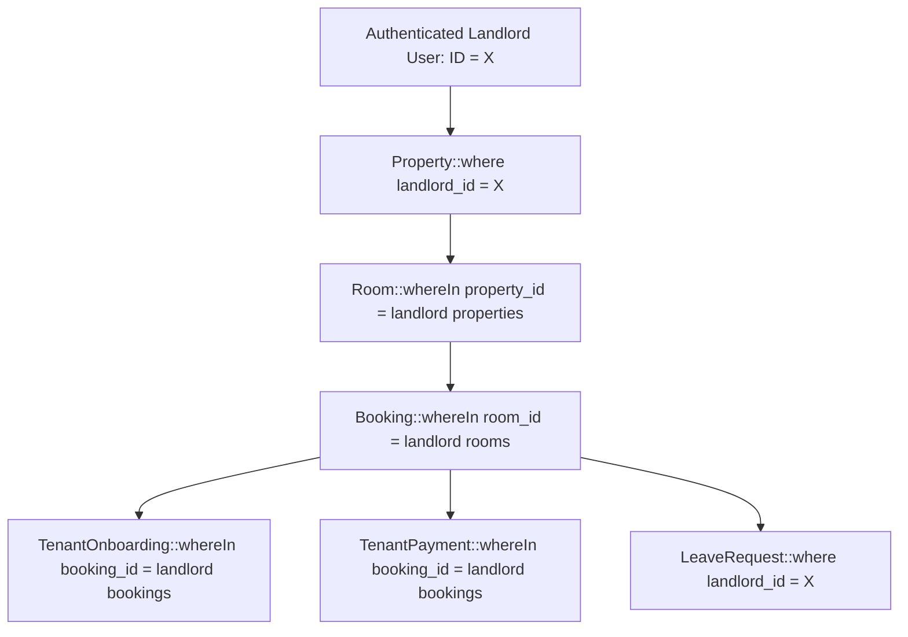

# Landlord Portal — Security & Role Isolation Audit

**Modules Audited:** Authentication, Authorization, Ownership Scoping, IDOR, File Privacy, CSRF, XSS  
**Audit Date:** 2026-10-08  

---

## 1. Role Boundaries & Authorization Architecture

### A. Middleware Perimeter:
- `auth`: Guarantees active session.
- `verified`: Requires verified email address.
- `role:landlord`: Blocks students and admins from accessing `/landlord/*` routes.
- `account.active`: Middleware appended to global `web` group ensuring deactivated accounts cannot access the portal (`bootstrap/app.php:27`).

### B. Ownership Scoping Across Endpoints:

---

## 2. In-Depth IDOR & Resource Ownership Audit

| Target Resource | Parameter | Authorization Mechanism | Tested IDOR Resistance | Assessment |
| :--- | :--- | :--- | :--- | :--- |
| **Properties** | `{property}` | `PropertyPolicy@update`, `delete`, `view` (`property->landlord_id === Auth::id()`). | Attempting to view/edit another landlord's property returns `403 Forbidden`. | **SECURE** |
| **Rooms** | `{property}`, `{room}` | `RoomController@getOwnedProperty` verifies property ownership; checks `$room->property_id === $property->id`; `RoomPolicy@update`. | Cross-property injection blocked with `404/403`. | **SECURE** |
| **Bookings** | `{booking}` | `BookingPolicy@approve`, `reject` verifies `$booking->room->property->landlord_id === Auth::id()`. | Approving another landlord's booking returns `403 Forbidden`. | **SECURE** |
| **Onboarding** | `{onboarding}` | `TenantOnboardingPolicy@reviewDocuments`, `approveDocuments`, `signContractAsLandlord` verifies relationship path. | Landlord cannot inspect or sign another landlord's onboarding. | **SECURE** |
| **Payments** | `{booking}`, `{record}` | `PaymentController@manageMonthly`, `storeMonthlyRecord`, `updateMonthlyRecordStatus` verifies `$booking->room->property->landlord_id === Auth::id()`. | Manipulation of `{booking}` or `{record}` IDs fails with `404`. | **SECURE** |
| **Leave Requests** | `{leaveRequest}` | `LandlordLeaveRequestController` checks `(int) $leaveRequest->landlord_id === (int) Auth::id()`. | Cross-landlord decision returns `403 Forbidden`. | **SECURE** |
| **Maintenance** | `{roomId}`, `room_id` | `MaintenanceController` checks `whereHas('property', landlord_id = Auth::id())`. | Toggling maintenance on another landlord's room fails with `404`. | **SECURE** |
| **Private Files** | `/files/{path}` | `FileController@show` parses path prefix (`landlords/{id}/...`, `tenant-onboardings/{id}/...`) and validates ownership against database relationships. | Non-owner access returns `403 Forbidden`. | **SECURE** |

---

## 3. General Security Findings

1. **CSRF Protection:** All `POST`, `PUT`, `DELETE` routes across the Landlord Portal include valid `@csrf` tokens or `X-CSRF-TOKEN` headers.
2. **Mass Assignment:** All Eloquent models use guarded `$fillable` arrays. No unfiltered `request()->all()` inputs are passed directly to `Model::create()` or `update()`.
3. **Password Security:** Handled via Laravel's native bcrypt hashers with standard validation rules.
4. **File Upload Validation:** All uploads enforce MIME-type inspection and file size boundaries.
5. **Direct Data Mutations in GET:** Verified that **NO GET requests modify database state**. All mutations require explicit POST, PUT, or DELETE verbs.

---

## 4. Summary of Security Ratings

| Security Dimension | Status | Notes |
| :--- | :--- | :--- |
| **Authentication & Session** | **PASS** | Strong role isolation and account active checking. |
| **Server-Side Authorization** | **PASS** | Strict policies and query scopes; no client-supplied IDs trusted. |
| **IDOR Resistance** | **PASS** | Nested relationships rigorously scoped. |
| **Private File Storage** | **PASS** | Authorized controller streaming via `FileController`. |
| **SQL Injection Safety** | **PASS** | Eloquent ORM parameterized queries throughout. |
