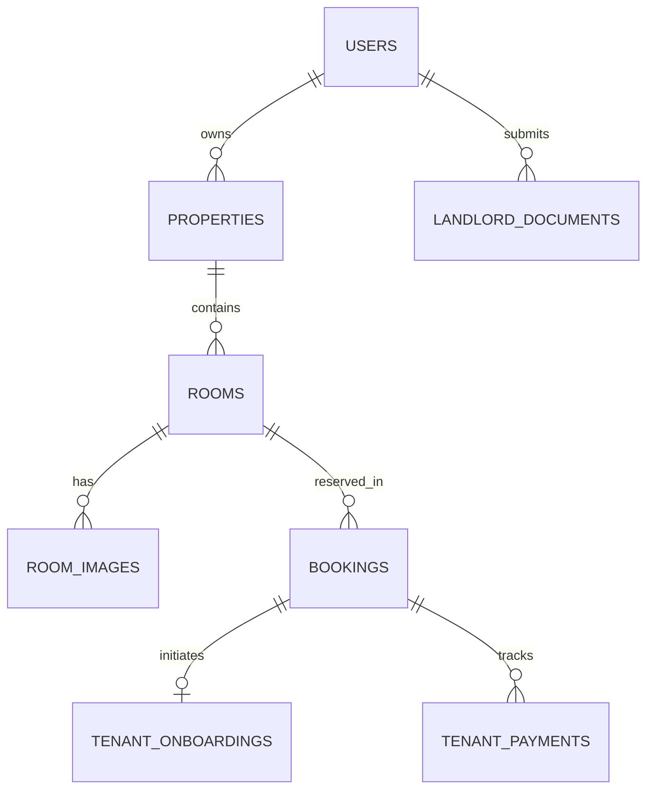

# Landlord Portal — Database & Data Consistency Audit

**Target:** MySQL 8.x / Strict Mode / Shared Hosting Invariants  
**Audit Scope:** Schema normalization, foreign keys, indexes, strict SQL compatibility, cross-portal data consistency  
**Date:** 2026-10-08  

---

## 1. Schema & Relational Integrity

### Key Relationships:
- `users` (landlords) `1 --- N` `properties`
- `properties` `1 --- N` `rooms`
- `rooms` `1 --- N` `room_images`
- `rooms` `1 --- N` `bookings`
- `bookings` `1 --- 1` `tenant_onboardings`
- `bookings` `1 --- N` `tenant_payments`
- `users` (landlords) `1 --- N` `landlord_documents`
- `rooms` `1 --- N` `room_feedbacks`

### Foreign Key & Cascade Analysis:

- **Cascade Vulnerability:** 
  - `properties` table has `cascadeOnDelete()` to `rooms`.
  - `rooms` table has `cascadeOnDelete()` to `bookings`.
  - `bookings` table has `cascadeOnDelete()` to `tenant_payments` and `tenant_onboardings`.
  - **Audit Risk:** If a property or room is deleted, historical financial records, lease contracts, and past student stay logs are permanently deleted from MySQL, destroying institutional auditability.

---

## 2. MySQL Strict Mode & `ONLY_FULL_GROUP_BY` Compatibility

- **Grep Inspection of Queries:**
  - Audited queries in `AuthController@landlordDashboard`, `PaymentController`, `BookingController`, and `AnalyticsController`.
  - All aggregation queries use explicit Eloquent relations, `withCount`, `sum()`, or standard parameterized `whereDate` / `whereBetween`.
  - No unaggregated columns exist in `groupBy` queries.
  - Full compatibility with MySQL 8.0 `ONLY_FULL_GROUP_BY` mode is maintained.

---

## 3. Cross-Portal Consistency Matrix

| Business Entity | Landlord Portal View | Student Portal View | Admin Portal View | Data Consistency Status |
| :--- | :--- | :--- | :--- | :--- |
| **Booking Approval** | Shows in `/landlord/bookings` (Approved) & `/landlord/tenants`. | Shows in `/student/requests` (Approved) & triggers Onboarding. | Shows in `/admin/bookings` & `/admin/boarding-monitoring/students`. | **CONSISTENT** |
| **Room Availability** | Shows in `/landlord/rooms` (Available slots computed via `RoomOccupancyRules`). | Shows in Marketplace room browser (`slots_available > 0`). | Shows in `/admin/properties/{id}` room breakdown. | **CONSISTENT** |
| **Document Verification** | Shows in `/landlord/documents` (Approved/Pending/Rejected). | N/A | Shows in `/admin/documents/verification` & `/admin/documents/monitoring`. | **CONSISTENT** |
| **Tenant Payment Status** | Shows in `/landlord/payments` (Paid / Pending / Overdue). | Shows in `/student/payments`. | Visible in Institutional Reports export. | **CONSISTENT** |
| **Leave Approval** | Marked Approved in `/landlord/leave-requests`. | Marked Approved in Student Onboarding panel. | Reflected in Stay History when check-out passed. | **INCONSISTENT (Premature stay cancellation before check-out date)** |
