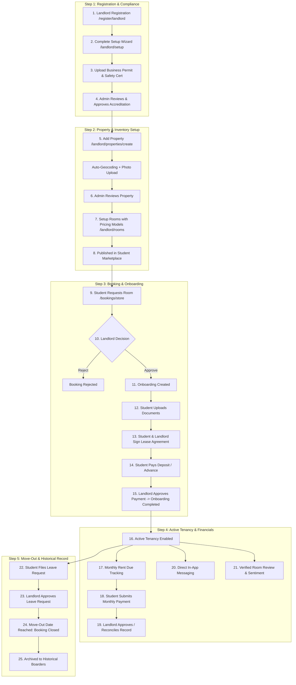

# Landlord Portal — End-to-End Workflow Map

**System:** Online Boarding House System (OBHS)  
**Lifecycle Flow:** Landlord Registration → Property Setup → Booking → Onboarding → Active Tenancy → Payments → Departure  
**Date:** 2026-10-08  

---

## 1. Visual Workflow Map

---

## 2. Transition State Specifications

| Step # | Transition Name | Triggering Actor | Preconditions | Database Updates | Capacity / Operational Effect |
| :---: | :--- | :--- | :--- | :--- | :--- |
| **1–4** | **Landlord Accreditation** | Landlord / Admin | Email verified, profile completed, valid permits uploaded. | `users`, `landlord_profiles`, `landlord_documents` (`verification_status = approved`). | Unlocks full management operations in UI. |
| **5–8** | **Property & Room Publishing** | Landlord / Admin | Property approved by Admin; at least 1 available room with pricing model. | `properties.approval_status = approved`, `rooms.status = available`, `slots_available > 0`. | Appears on student map and search results. |
| **9–10** | **Booking Approval** | Landlord | Student academic verification approved; room has available slots. | `bookings.status = approved`, `occupancy_mode` set, overlapping pending requests auto-rejected if full. | Room available slots decrement via `RoomOccupancyRules`. |
| **11–15** | **Tenant Onboarding Completion** | Student / Landlord | Documents uploaded, lease agreement e-signed by both parties, deposit paid & approved. | `tenant_onboardings.status = completed`, `deposit_paid = true`, `bookings.payment_status = paid`. | Student tenant dashboard unlocked; digital ID issued. |
| **16–19** | **Monthly Rent Cycle** | Student / Landlord | Active tenancy; monthly due date reached. | `tenant_payments.status = approved`, `bookings.next_payment_due_date` advanced by 1 month. | Ledger balance updated; student receives receipt notification. |
| **22–25** | **Move-Out & Departure** | Student / Landlord | Active booking exists; leave date specified. | `leave_requests.status = approved`, `bookings.check_out = leave_date`. | Room slots restored for future booking dates once move-out finalized. |
